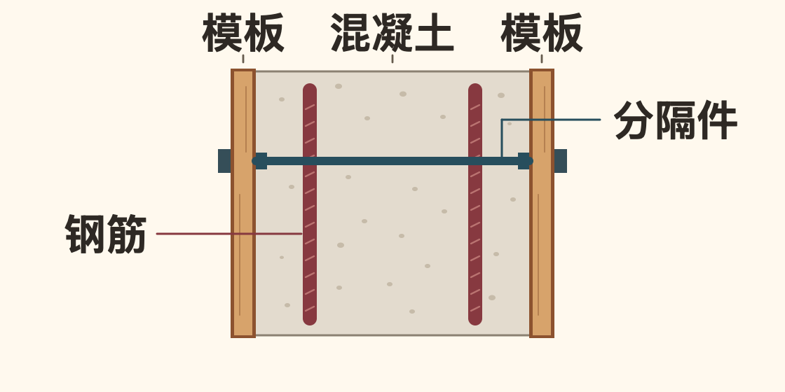

主角在狮子堂建设做暑期工，跟着熊手、文治和斗次郎学加工板件、放线和支模。

## 「木工」和「模板工」是同一个工种吗？ {#trades data-lookup="木工 木匠 大工 模板木工 模板工 型枠大工 工种 RC结构"}

游戏里的这班工人做的是**模板工**，日语叫「型枠大工（かたわくだいく）」，现场对白有时简称「大工」。D2 午休，文治用木造房子来说明区别。木造木工做的木结构留在房子里，模板工做的板面和支撑则是临时的。它们让刚浇进去的混凝土保住墙、柱或楼板的形状，等达到拆模条件再拆。 [日本厚生劳动省的建筑工种介绍](https://kensetsu-welcome.mhlw.go.jp/character/)

| 工种与人物 | 在现场做什么 |
| :------------------- | :------------------------- |
| **模板工** 型枠大工 主角、熊手、文治、斗次郎 | 按图加工板件，到现场组装和拆除模板。 |
| **电工** 電気屋 笹吉 | 做楼里的电气施工。D10 他报的任务是三楼配线。 |
| **钢筋工** 鉄筋屋 北野门左卫门 | 搬入、布置和绑扎钢筋，做出墙、柱和楼板内的钢筋骨架。 |
| **架子工** 鳶、足場屋 鹞鹰 | 随楼层施工搭设、接高和拆除脚手架。 |

这些分工在中国建筑工地也有对应工种。日语的「鳶（とび）」涵盖得更广，搭脚手架是其中一支，还有负责钢结构安装的「鉄骨鳶」。 [日本建筑职业分类](https://www.hellowork.mhlw.go.jp/info/mhlw_job_dictionary_10.html) · [日本电工的工作内容](https://shigoto.mhlw.go.jp/User/Occupation/Detail/46) · [中国建筑工种目录](https://zjt.hunan.gov.cn/zjt/xxgk/xinxigongkaimulu/tzgg2zhyw/202207/t20220720_29310261.html)

## D2 · 斗次郎为什么拿挤塑板午睡？ {#insulation-board data-lookup="斗次郎 午睡 垫子 挤塑板 断热材 隔热材料 保温板 スタイロ スタイロフォーム XPS"}

斗次郎铺在地上的「スタイロ」，简中译成「挤塑板」。日本的「スタイロフォーム」是挤塑聚苯乙烯（XPS）建筑保温板。泡沫板导热慢，身体的热量传到地面也更慢，斗次郎才会说垫着它没那么凉，还把它当午睡的垫子。 [スタイロフォーム产品说明](https://www.dupontstyro.co.jp/faq/styrofoam.html)

## D5 · 模板为什么要写编号？ {#fabrication data-lookup="加工场 加工单 加工账 加工帳 胶合板 垫木 桟木 模板编号"}

文治拿出「加工单」（加工帳）。图上的大方块是胶合板，细长方块标出要钉在板背的木条。主角按图把板件做好，再用记号笔写下「A1 柱右」一类的编号。同一批板捆好后还有标识牌，运到工地也能看出这批板用在哪。

日本的模板施工公司也会把建筑图纸转成加工图，在加工场按尺寸裁板、钉木条，然后把做好的部件运到现场。游戏里纸上的编号对应将来要安装的位置，墙角、柱侧这些外观相近的板件到场后就有了可辨认的标记。 [高千穗建设的型枠工序](https://www.takachihokensetsu.com/works.html)

## D6 · 工地说的「扶手」是什么？ {#edge-formwork data-lookup="扶手 围栏 护栏 栏杆 手摺り 手摺り型枠 楼板边缘 侧模 天端 面木 倒角"}

主角在 D2 往上递的「围栏」，D6 斗次郎要他加工的「扶手」，都是这班人对楼板外缘一带的**模板**的叫法。斗次郎说的「天端」（てんば）在这里指模板的上沿，混凝土要浇到的最高位置。D9 说「拆扶手」时，拆的也是带钢管、扣件和编号的模板。

斗次郎还让主角在上沿钉一条横截面呈三角形的「面木」（めんぎ）。这根小木条占住模板内侧的一角。浇完拆模后，那处混凝土的棱边就会留出一道斜面，也就是倒角。 [日本厚生劳动省的模板工教材 · 面木](https://www.mhlw.go.jp/bunya/nouryoku/gaikoku/dl/2-3.pdf)

## D9 · 为什么在楼板上弹墨线？ {#layout data-lookup="放线 弹墨线 墨斗 墨出し 亲墨 親墨 基准墨线 通り芯 楼板 水平尺 水平仪 垂直"}

穴盛用测量仪确定基准，文治拿卷尺和铅笔在楼板上标点。主角帮他按住墨绳的一端，绳子拉紧后弹一下，两点之间就印出一条直线。游戏把基准墨线叫作「親墨」。工人再按图从基准量出墙和柱的位置，标出模板要立在哪里。基准偏了，从它量出去的位置也会跟着偏。 [铜谷建设的放线与支模说明](https://douyakensetsu.co.jp/katawakutoha.html)

到 D10，文治解释可以用带气泡的水平尺贴着模板检查垂直。D9 地上的墨线管墙脚的位置，D10 的水平尺管墙模立起来有没有歪。 [高千穗建设的测量与支模工序](https://www.takachihokensetsu.com/works.html)

## D10 · 模板工为什么要等钢筋工？ {#formwork data-lookup="支模 钢筋 模板 分隔件 间隔件 对拉螺杆 セパ フォームタイ 浇筑 墙体剖面 布丁 生混凝土 侧压力"}

文治用布丁杯打比方。新拌混凝土像还没凝固的布丁液，浇进去时会往两侧推。横在两面模板之间的「分隔件」（セパ）和外侧紧固件一起抵住这个力，维持墙体所需的厚度。 [国元商会的模板分隔件说明](https://kunimoto-s.co.jp/product/formwork/separeta/b) · [铜谷建设的型枠组装说明](https://douyakensetsu.co.jp/katawakutoha.html)

文治还说，这面墙底下的钢筋要是还没绑好，就先空着最下面一排分隔件。金属杆横过去以后，会挡住钢筋工的操作空间。

{fig-alt="墙体简化剖面，两侧模板夹着混凝土和钢筋，分隔件横跨两板之间。"}

## D9–D12 · 为什么一边拆模板，一边把材料往上搬？ {#reuse data-lookup="拆模 拆扶手 梁底 支撑杆 钢管支柱 ポスト 拆除 复用 转用 荷揚げ 吊料 上料 递料 上料口"}

D9 下午拆墙模时，斗次郎特意让主角留下梁底和顶着它的支柱（ポスト）。墙侧的板主要给混凝土定形，梁底下的支柱还承担着施工阶段的重量。日本公共建筑的标准规格也把模板面板与支柱的留置条件分别列出，按部位和混凝土龄期或强度判断。 [日本国土交通省《公共建筑工程标准规格》· 6.8.4 型枠的留置与拆除](https://www.mlit.go.jp/gobuild/content/001888816.pdf)

拆下来的板还要接着用。D9 斗次郎让主角看好板上的编号，等脚手架接高再运上去。D10 是主角在楼下递板，斗次郎在上面接。D12 搬楼板材料时，主角站在中间一层接支柱，再递给更上面的文治。游戏里的「荷揚げ」也会译成「吊料」，这几段实际画的是靠人接力往上送。日本模板施工公司也有把下层拆出的板件转用到上层、在受场地限制时靠人力上料的实例。 [藤一的拆模与上层转用](https://fujiichicorp.co.jp/service/formwork/) · [小暮工业的公寓施工记录](https://kogurekogyo.co.jp/construction_flow/construction01)

D12 搬完后，文治还提醒把上料口的盖子盖上。这个在楼板间传料的洞口，停用时需要恢复防护，避免有人踩空。 [日本厚生劳动省的工地安全教材 · 楼板洞口](https://www.mhlw.go.jp/content/11300000/000609002.pdf)

## D3、D13、D15 · 混凝土还没浇，为什么先标预埋件？ {#slab-inserts data-lookup="楼板预埋件 预埋件 板内埋件 板插销 スラブインサート 红圈 标记 笹吉 吊杆 电气设备"}

D3，文治让主角给这一层已经装好的楼板预埋件画圈，作为下一层定位的参考。D13，他又提醒板铺反了，后来装的预埋件也会跟着偏。D15，笹吉给主角指出红圈是电气设备的预埋件。楼板浇筑之前，各班已经要决定将来在哪些位置挂东西。

「楼板预埋件」（スラブインサート）可以理解成提前放进楼板里的带螺纹固定点。浇筑前把它固定在模板上，拆模后就能从楼板下方拧入吊杆，用来挂吊顶、管道或电气设备。现实工地也会用颜色区分不同专业的预埋件，具体颜色依工程约定。 [三门的预埋件用途说明](https://www.mikado-nt.co.jp/m04.htm) · [日本大津市机电施工监督手册 · 预埋件分色](https://www.city.otsu.lg.jp/material/files/group/31/kikai_kanri_note_H31.pdf)

## 朝会为什么要一个班组一个班组报？ {#morning-briefing data-lookup="朝会 朝礼 晨会 穴盛 监督 班组 安全注意事项 人数 危险预知 KY"}

D9 朝会，穴盛请狮子堂建设、熊野钢筋和高海架设分别报当天的作业、安全注意事项和人数。熊手这班报楼板放线和拆模，北野门那班要搬钢筋、给柱子配筋，鹞鹰那班则要接高脚手架。大家在同一栋楼里同时作业，开工前先知道别的班要在哪一层干什么。

日本工地的安全朝礼也会共享当天的安排和危险区域。之后，各班可以结合自己的作业做「危险预知」（KY），讨论当天可能在哪里夹手、哪里有坠落风险，再定这个班要怎么配合。 [日本中小建设业特别教育协会的安全朝礼与危险预知说明](https://www.tokubetu.or.jp/text_shokuan/part11/text_shokuan11-1.html)

## D24 · 台风前为什么要收脚手架围护网？ {#scaffold data-lookup="台风 鹞鹰 架子工 脚手架 足場 围护网 防护网 网布 防风"}

这天朝会，穴盛宣布次日停工，提醒大家在收工前固定好容易被吹走的材料。鹞鹰说，脚手架上的网布好不容易挂上去，台风前又得卸下来，风过去再挂。网布铺开会增大脚手架的受风面积。日本厚生劳动省的脚手架安全指引也把收拢网布或隔音布列为强风停工期间减少脚手架倒塌风险的措施之一。 [日本厚生劳动省的脚手架安全指引](https://www.mhlw.go.jp/web/t_doc?dataId=00tc8166&dataType=1)
